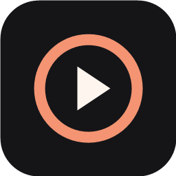
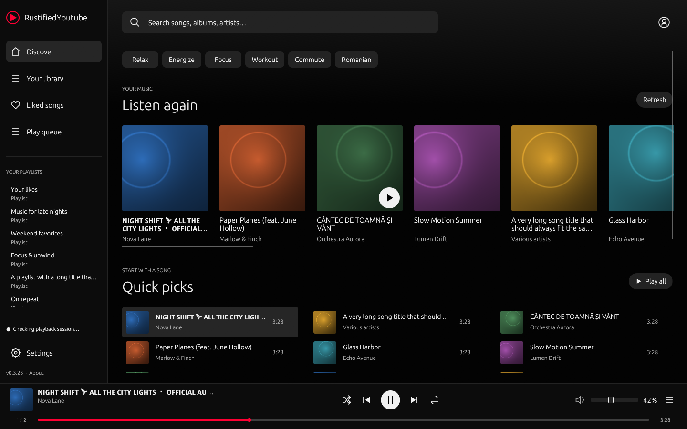
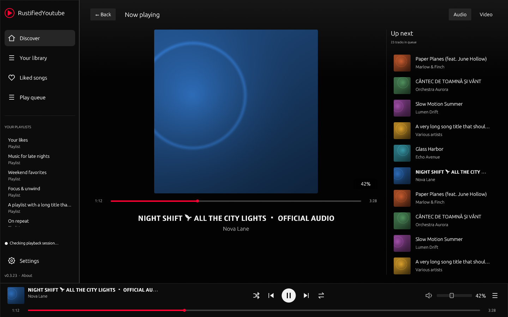
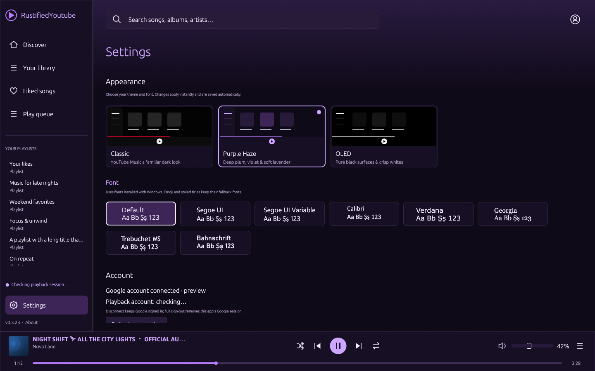

<p align="center">
  
</p>

<h1 align="center">RustifiedYoutube</h1>

<p align="center">
  A fast, native YouTube Music player for Windows, written in Rust.
</p>

<p align="center">
  <a href="https://github.com/zygerr/RustifiedYoutube/releases/latest"></a>
  <a href="https://github.com/zygerr/RustifiedYoutube/actions/workflows/windows.yml"></a>
  
  <a href="LICENSE"></a>
</p>



<table>
  <tr>
    <td></td>
    <td></td>
  </tr>
</table>

## Install

1. Download **`RustifiedYoutube_<version>_x64-setup.exe`** from the [latest release](https://github.com/zygerr/RustifiedYoutube/releases/latest).
2. Run it. Windows may show a SmartScreen warning because the app isn't code-signed — choose **More info → Run anyway**.
3. Open RustifiedYoutube and choose **Continue with Google** to sign in (optional — search and playback also work without an account).

Needs Windows 10 or 11 (x64) and the [Microsoft WebView2 Runtime](https://developer.microsoft.com/microsoft-edge/webview2/), which Windows 11 already includes. Prefer no installer? Download the portable ZIP, extract all of it, and run `RustifiedYoutube.exe`.

## Features

- **Your music** — search songs and videos, browse your playlists, liked songs and listening history, and like or unlike tracks.
- **Native interface** — a quick Rust interface with a play queue, shuffle, repeat, and an expanded player that switches between audio and music video.
- **Make it yours** — three themes (Classic, Purple Haze, OLED) and eight fonts, applied instantly.
- **Works with Windows** — keyboard media keys, taskbar thumbnail buttons, the tray, and the volume mixer.
- **Discord Rich Presence** — shows *Listening to* the song (or artist) you're playing, with a *Listen on YouTube Music* button.
- **Streams instantly** — playback uses the official YouTube Music player, so nothing is downloaded.

## Shortcuts

| Action | Shortcut |
| --- | --- |
| Play / pause | Media key, or `Ctrl` + `Alt` + `Space` |
| Next / previous | Media keys |
| Search | `Ctrl` + `K` |
| Seek 5 seconds | `←` / `→` on the progress bar |
| Volume | Scroll over the volume slider or the album art (step set in **Settings → Playback**) |
| Quit | `Ctrl` + `Q` |

Closing the window keeps music playing in the tray. You can change that in **Settings**.

## Privacy

Everything stays on your PC. Your Google sign-in lives in the app's own browser profile, and the library session is encrypted with Windows (DPAPI) for your user account. Nothing is sent anywhere except YouTube, Google and — if you turn it on — your local Discord app, which only receives the song details. The debug log never contains your cookies or password.

## Troubleshooting

If something goes wrong, click **Open logs** on the error message (or **Settings → Diagnostics → Open log folder**) and attach `RustifiedYoutube.log` to an [issue](https://github.com/zygerr/RustifiedYoutube/issues).

## Building from source

```powershell
cargo run -p rustified-youtube-native --locked   # run the app
./scripts/build-native.ps1                       # build the installer and portable ZIP into dist/
```

You'll need Rust (MSVC toolchain) and the Microsoft C++ Build Tools. See [docs/DEVELOPMENT.md](docs/DEVELOPMENT.md) for tests, live checks, screenshots and releases, and [CHANGELOG.md](CHANGELOG.md) for what's new.

## License

[MIT](LICENSE) © zygerr. Third-party components keep their own licenses — see [THIRD-PARTY-NOTICES.md](THIRD-PARTY-NOTICES.md).

---

RustifiedYoutube is an independent project and isn't affiliated with Google or YouTube. Playback follows YouTube's normal availability, account and advertising rules; use the account with YouTube Premium for its benefits. The streaming approach was inspired by [ytmdesktop](https://github.com/ytmdesktop/ytmdesktop).
